# P4 Depth Map Upsampling System

## Technical Document

**Document style:** ASD-STE100 (Simplified Technical English)
**Project name:** P4 Edge-Preserving Depth Map Upsampling and Refinement
**Event:** Computer Vision Hackathon 2026, Problem Statement 4 (P4)
**Source:** Repository `CV-Hackthon-raksh01`
**Team:** Rakshitha, Tanush, Rishita, Kumar

> **NOTE:** This document uses the rules of ASD-STE100. Sentences are short. Each term has one meaning. The document states facts from the source files. It does not add new facts.

---

### Document overview

| Item | Value |
|---|---|
| **System goal** | Convert low-resolution depth into high-resolution depth. |
| **Primary design** | Classical, deep and hybrid reconstruction branches. |
| **Guidance input** | High-resolution RGB image. |
| **Output** | High-resolution `float32` depth map. |

---

## 1 Scope

### 1.1 Purpose of this document

This document describes the P4 system. It gives the design, the data rules, the procedures and the test results. It also gives the limits of the system.

### 1.2 Purpose of the system

The system changes a low-resolution depth map into a high-resolution depth map. The output keeps the edges of objects. The output keeps the depth steps between near and far objects.

The system can also fill missing depth values. The system can reduce noise in the depth values.

### 1.3 Problem statement

The hackathon asks this question: How can you build an edge-aware system that changes sparse or low-resolution depth maps into dense, high-resolution depth maps? The system must keep object boundaries, shapes and depth discontinuities.

The system must solve these problems:

- Missing depth values
- Sensor noise
- Depth steps between foreground and background objects
- Texture-copy errors
- Wrong object boundaries

---

## 2 Terms and abbreviations

| Term | Meaning |
|---|---|
| Depth map | An image. Each pixel holds a distance value. |
| LR | Low resolution |
| HR | High resolution |
| RGB | Red, green, blue color image |
| Scale | The ratio of HR size to LR size. A scale of 4 gives an output that is 4 times larger in width and in height. |
| Valid mask | A true/false image. True means the depth value is a real measurement. |
| Hole | A pixel with no valid depth value |
| Depth discontinuity | A large jump in depth between two near pixels |
| Guidance image | The HR RGB image that helps to find edges |
| Texture copying | An error. Color patterns in the RGB image appear in the depth output. |
| Classical branch | The part of the system that uses non-learned methods |
| Deep branch | The part of the system that uses a neural network (SGNet) |
| Hybrid branch | The part of the system that combines the classical branch and the deep branch |
| SGNet | A guided depth super-resolution neural network. It is from the AAAI 2024 paper. Its license is Apache-2.0. |
| JBU | Joint bilateral upsampling |
| Guided filter | An edge-preserving filter. It uses a guidance image. |
| Forward operator (S) | The process that makes an LR depth map from an HR depth map. In this project, S is a bicubic downsample. |
| Measurement consistency | A correction step. It makes the output agree with the LR measurements. |
| Alpha | The classical share in the hybrid blend. It is a number from 0 to 1. |
| RMSE | Root mean square error |
| MAE | Mean absolute error |
| PSNR | Peak signal-to-noise ratio |
| SSIM | Structural similarity index |
| Boundary RMSE | RMSE in a narrow band around ground-truth depth discontinuities |
| Edge F1 | The F1 score between predicted depth edges and ground-truth depth edges |
| NYU | NYU Depth v2 data set |
| GT | Ground truth |
| CLI | Command-line interface |
| UI | User interface |
| VRAM | Video memory of the GPU |

---

## 3 System description

### 3.1 General description

The system has four layers.

| Layer | Folder | Function | Status in source |
|---|---|---|---|
| Classical | `classical/` | Fit the measured LR samples. Use the RGB image to sharpen depth edges. Provide interpolation, JBU and guided-filter baselines. | Implemented and tested |
| Deep | `deep/` | Run SGNet. Load data sets. Degrade data. Run inference. | Implemented. A checkpoint is necessary. |
| Hybrid | `hybrid/` | Estimate confidence. Fuse the two branches. Refine boundaries. Apply measurement consistency. | Implemented and tested |
| Evaluation | `eval/` | Compute RMSE, MAE, PSNR, SSIM, boundary RMSE and edge F1. Run benchmarks. | Implemented |
| Application | `main.py`, `app/` | Provide the CLI and the Gradio web UI. Validate inputs. Export results. | Implemented |

### 3.2 System architecture

```mermaid
flowchart LR
    I["Inputs<br/>HR RGB + LR depth + valid mask"] --> P["Preprocessing<br/>Validation, normalization<br/>and hole handling"]

    P --> C["Classical branch<br/>classical/"]
    P --> D["Deep branch<br/>deep/ · SGNet"]

    C --> COUT["Classical estimate<br/>D_c (HR)"]
    D --> DOUT["Deep estimate<br/>D_d (HR)"]

    COUT --> F["Hybrid fusion<br/>hybrid/"]
    DOUT --> F

    F --> W["Confidence estimation<br/>W_c, W_d"]
    W --> A["Adaptive fusion<br/>D_f = W_c D_c + W_d D_d"]
    A --> R["Boundary refinement<br/>Optional"]
    R --> M["Measurement consistency<br/>Optional"]

    M --> O["Final HR depth<br/>(H, W), float32"]
    O --> CLI["CLI output<br/>main.py"]
    O --> UI["Gradio UI<br/>app/ui.py"]
    CLI --> E["Export<br/>app/visualization.py"]
    UI --> E

    classDef input fill:#E8F1FB,stroke:#2563EB,color:#0F172A,stroke-width:1.5px;
    classDef branch fill:#F3E8FF,stroke:#7C3AED,color:#0F172A,stroke-width:1.5px;
    classDef process fill:#ECFDF5,stroke:#059669,color:#0F172A,stroke-width:1.5px;
    classDef output fill:#FFF7ED,stroke:#EA580C,color:#0F172A,stroke-width:1.5px;

    class I,P input;
    class C,D,COUT,DOUT branch;
    class F,W,A,R,M process;
    class O,CLI,UI,E output;
```



The diagram shows the main system architecture and data path. Optional stages remain in the path so that the document shows their position in the final pipeline.

### 3.3 Key rule of the design

The system never changes the original depth values in place. The system never changes the original valid mask in place. Each branch works on copies. A filled value is never the same as a measured value.

The system finds depth discontinuities from depth first. RGB edges are only supporting evidence.

### 3.4 Inputs

| Input | Format | Required |
|---|---|---|
| HR RGB image | `(H, W, 3)`, uint8 or float32 in the range 0 to 1 | Yes |
| LR depth map | `(h, w)` float32. Unit: meters for NYU. Format: `.npy` or an image file. | Yes |
| Valid mask | `(h, w)` bool at LR size. Non-zero means valid. | No |
| Scale | Whole number | Yes |
| Method | Name from the method list | Yes |
| HR ground truth | Depth file | No. It gives metrics and an error map. |

### 3.5 Outputs

- The HR depth map. Shape: `(H, W)`. Type: float32. Unit: same as the LR depth.
- The `.npy` file (float32 depth).
- The `.png` file (16-bit, min-max scaled preview).
- The color-map image.
- The error map (only with ground truth).
- The side-by-side comparison image (with `--compare`).

### 3.6 Frozen input rules

The file `data/preprocessing.py` holds these rules.

- `hr_rgb` is `(H, W, 3)` RGB. Type is uint8 or float32 in the range 0 to 1.
- `lr_depth` is `(h, w)` float32. It uses the unit of the data set.
- `valid_mask` is `(h, w)` bool at LR size. `None` means the system finds the mask from the depth.
- The output is `(H, W)` float32. `H` equals `h` times the scale.
- The system never treats a depth value as a measurement if the value is 0 or less, NaN or Inf.

### 3.7 Public functions

```python
classical_hr_depth(lr_depth, hr_rgb, valid_mask=None, scale=4, *, mode="bicubic") -> (H, W) float32
deep_hr_depth(lr_depth, hr_rgb, valid_mask=None, scale=4) -> (H, W) float32
hybrid_hr_depth(lr_depth, hr_rgb, valid_mask=None, scale=4) -> (H, W) float32
```

The function `main.reconstruct` returns a dictionary. The keys are `depth`, `method`, `requested_method`, `fallback`, `notes` and `intermediates`.

---

## 4 Reconstruction methods

| Method | Type | Description | Scales |
|---|---|---|---|
| `nearest` | Baseline | Nearest-neighbor interpolation | 2, 4, 8, 16 |
| `bilinear` | Baseline | Bilinear interpolation | 2, 4, 8, 16 |
| `bicubic` | Baseline | Bicubic interpolation | 2, 4, 8, 16 |
| `jbu` | Classical | Joint bilateral upsampling | 2, 4, 8, 16 |
| `guided` | Classical | Guided filter on a bilinear result | 2, 4, 8, 16 |
| `classical` | Classical | Iterative fit to the LR samples. It uses RGB guidance to sharpen depth-supported edges. | 2, 4, 8, 16 |
| `adaptive_jbu` | Classical | JBU with a depth gate | 2, 4, 8, 16 |
| `refined_jbu` | Classical | `adaptive_jbu` plus boundary refinement | 2, 4, 8, 16 |
| `deep` | Deep | SGNet. An official checkpoint is necessary. | 4, 8, 16 |
| `hybrid` | Hybrid | Blend of the classical output and the deep output | 4, 8, 16 |

> **NOTE:** SGNet has no checkpoint for scale 2. For scale 2, the `deep` method gives an error. For scale 2, the `hybrid` method uses the classical branch. The system reports this fallback.

---

## 5 Classical branch

### 5.1 Modules

| File | Function |
|---|---|
| `interpolation.py` | Nearest, bilinear and bicubic baselines. It handles missing depth. |
| `jbu.py` | Joint bilateral upsampling. It uses a hard color gate and an optional depth gate. |
| `guided_filter.py` | Guided filter that knows which pixels are valid (method of He et al.). |
| `hole_filling.py` | `prepare_depth` finds valid pixels. It also does careful hole filling. |
| `boundary_refinement.py` | Finds depth discontinuities. It refines edges. |
| `adaptive_jbu.py` | Measures the agreement between depth edges and RGB edges. |
| `variational.py` | RGB-guided reconstruction from masked, antialiased depth measurements. |
| `classical_hr_depth.py` | The public wrapper and the `reconstruct` router. |
| `benchmark.py` | A synthetic benchmark. |

### 5.2 Behavior of the `classical` method

The solver uses the antialiased bicubic sampling model as the default. The solver accepts `mode="bilinear"` or `mode="nearest"` if the LR data came from that sampling model.

Hole fills set the first estimate. Only valid LR pixels add to the measurement error.

### 5.3 Rules for edges

- Use RGB edges as guidance only.
- Do not use RGB edges as the true depth boundaries.
- Do not smooth across true depth discontinuities.
- Do not move RGB texture edges into the depth output.

---

## 6 Deep branch (SGNet)

### 6.1 Model facts

- The model is the official SGNet. It uses guided depth super-resolution. The license is Apache-2.0. The folder `deep/sgnet/` holds a copy of the code.
- The only change to the copy is the removal of hard-coded `.cuda()` calls. The checkpoint keys are the same.
- The model has one checkpoint for each scale.

| Scale | `num_feats` | Parameters | Checkpoint file | File size |
|---|---|---|---|---|
| 4 | 48 | 36.4 M | `SGNet_X4_R.pth` | 140.1 MB |
| 8 | 40 | 39.9 M | `SGNet_X8_R.pth` | 153.3 MB |
| 16 | 40 | 86.6 M | `SGNet_X16_R.pth` | 331.4 MB |

### 6.2 Native input and output

- The native call is `net((rgb, lr_depth))`.
- `rgb` has shape `(N, 3, H, W)` in the range 0 to 1.
- `lr_depth` has shape `(N, 1, H/s, W/s)`. Do not upsample it before input. The system normalizes it with the min-max of the valid LR values.
- The output is the normalized HR depth.
- SGNet has no mask channel. The system fills the invalid LR pixels with the nearest valid value in a working copy. The output is the raw prediction at all pixels.
- The model trained on synthetic NYU-v2 data with bicubic LR input.

### 6.3 Other deep-branch files

| File | Function |
|---|---|
| `deep_model.py` | Builds SGNet. Loads and checks the checkpoint. |
| `inference.py` | `deep_hr_depth` wrapper. Handles the device. Runs tiled inference. Profiles speed and memory. |
| `settings.py` | Supported scales, checkpoint paths and exceptions |
| `routing.py` | Selects a checkpoint from the quality of the input |
| `tta.py` | Test-time augmentation |
| `finetune.py` | Fine-tuning script |
| `finetune_realistic.py` | Fine-tuning script for realistic degradation |
| `finetune_robust.py` | Fine-tuning script for missing depth |

### 6.4 Checkpoint routing

The file `deep/routing.py` selects a checkpoint from the input quality.

- Use the original checkpoint if the LR depth has no holes and the noise is below a limit.
- Use the robust fine-tuned checkpoint in all other cases.

The hole limit is 0.005 (fraction of invalid LR pixels). The noise limit is 0.002 m. The source calls the noise limit a placeholder. The robust checkpoint is optional. If it is not set, the system uses the available scale checkpoint for both routes.

### 6.5 Environment variables

| Variable | Use |
|---|---|
| `SGNET_CKPT_DIR` | Folder of checkpoints. Default: `checkpoints/sgnet`. |
| `SGNET_CKPT_X4`, `SGNET_CKPT_X8`, `SGNET_CKPT_X16` | Path of one checkpoint |
| `SGNET_CKPT_X4_ROBUST` (and X8, X16) | Path of the robust checkpoint |
| `P4_DATA_ROOT`, `NYU_ROOT`, `MIDDLEBURY_ROOT`, `LU_ROOT` | Data set locations |
| `P4_CONFIG` | Path of the configuration file |
| `PORT` | Web server port. Default: 8080. |

### 6.6 Exceptions

| Exception | Cause |
|---|---|
| `UnsupportedScaleError` (a `ValueError`) | The scale has no checkpoint |
| `DeepModelUnavailableError` (a `RuntimeError`) | The checkpoint is missing or does not match. Also CUDA errors and out-of-memory errors. |

The UI must catch both exceptions.

### 6.7 Limits of the deep branch

- Tiled inference is a fallback. It starts after an out-of-memory error, or when `tile_lr` is set. It does not give the same result as full-image inference. SGNet has global FFT blocks.
- Only fp32 precision is possible. The cuFFT half-precision mode supports only power-of-two sizes.
- The checkpoints are trained on the NYU train split.

---

## 7 Hybrid branch

### 7.1 Modules

| File | Function |
|---|---|
| `confidence.py` | `estimate_confidence` gives the normalized weights `W_c` and `W_d`. `quality_blend` sets alpha from the input quality. |
| `fusion.py` | `fuse` (adaptive fusion). `fuse_fixed` (fixed fusion, for ablation). |
| `consistency.py` | Measurement-consistency correction |
| `boundary_refinement.py` | `refine_hybrid_depth` |
| `pipeline.py` | `hybrid_hr_depth` and `ablations` |

### 7.2 Fusion

The fusion formula is:

$$
\begin{aligned}
D_f &= W_c D_c + W_d D_d,\\
W_c + W_d &= 1.
\end{aligned}
$$

The weights are normalized scores. They are not calibrated probabilities.

If the deep output is not finite at a pixel, the system uses the classical value at that pixel.

### 7.3 Classical share (alpha)

The default setting is `hybrid.classical_alpha: null`. This setting adapts the classical share to the noise and the missing pixels in the LR input.

- The share is 2% for clean input.
- The share can reach 65% for noisy input.
- The share can reach 90% for incomplete input.

A number in the range 0 to 1 sets a fixed share.

The adaptive rule in `quality_blend` is:

$$
\begin{aligned}
\alpha &= 0.02 + \max\left(0.63\,n,\;0.88\,h\right),\\
n &= \operatorname{clip}\left(\frac{\text{noise}-0.003}{0.006},\,0,\,1\right),\\
h &= \operatorname{clip}\left(\frac{\text{missing}-0.04}{0.19},\,0,\,1\right).
\end{aligned}
$$

Here, \(n\) is `noise_level` and \(h\) is `hole_level`.

The rule also gives a damping factor for the consistency strength: `1 - noise_level`.

> **NOTE:** The files `docs/ARCHITECTURE.md` and `docs/HYBRID_FUSION.md` state that the frozen default is a fixed alpha of 0.02. The file `configs/default_config.yaml` and the file `README.md` state that the default is adaptive (`null`). See Section 15.

### 7.4 Measurement consistency

If the forward operator S is known, the system does these steps:

$$
\begin{aligned}
r_{\mathrm{LR}} &= D_{\mathrm{LR}} - S(D_f)
&& \text{at valid LR pixels only},\\
D_f' &= D_f + \text{strength}\cdot\operatorname{upsample}
       \left(r_{\mathrm{LR}}\right).
\end{aligned}
$$

- The default strength is 0.25. The default number of iterations is 1.
- The adaptive setting lowers the strength when the estimated noise is high.
- The system ignores invalid LR pixels in each iteration.
- The residual upsample is an approximation. It is not an exact projection.

> **WARNING:** Measurement consistency is valid only if the forward operator is known. For real sensor data with an unknown degradation, set `use_consistency: false`.

### 7.5 Boundary refinement

Boundary refinement uses depth discontinuities as the main evidence. RGB is supporting evidence. The default setting is off. On the 30-image validation set, refinement increased RMSE (0.0141 against 0.0123). The system keeps the code for ablation.

### 7.6 Ablations

`hybrid/ablations()` returns these cases:

1. Classical only
2. Deep only
3. Deep plus consistency
4. Fixed fusion
5. Fixed fusion plus consistency
6. Adaptive fusion
7. Adaptive fusion plus consistency
8. Boundary-refined final case

### 7.7 Fallback behavior

If the deep branch is not available, the hybrid method returns the classical output. The system reports `fallback=True` and the reason in `notes`. The output files use the name of the method that ran. The system does not label a classical result as a hybrid result.

A deep branch can be not available for these reasons: no checkpoint, an unsupported scale, no torch, or a CUDA error.

The function `hybrid_hr_depth` itself raises `NotImplementedError` when the deep branch is not available.

---

## 8 Data and evaluation

### 8.1 Data sets

| Data set | Use | Unit | Status |
|---|---|---|---|
| NYU Depth v2 | Main RGB-D benchmark. Dense GT. LR is made from GT. | Meters | Used |
| Middlebury Stereo | Extra guided depth SR benchmark | Disparity (8-bit) | Used |
| KITTI | Listed in the problem statement | - | **Not verified.** `get_dataset('kitti')` raises an error. |

Data sets and checkpoints are not in the repository. See `.gitignore`.

### 8.2 NYU files

Put these files in `datasets/nyu_data/`:

- `train_depth_split.npy`
- `train_images_split.npy`
- `test_depth.npy`
- `test_images_v2.npy`
- `test_minmax.npy`

Middlebury and Lu files go in `datasets/Middlebury/` and `datasets/Lu/`. The files are `output_color_*.png` and `output_depth_*.png`.

### 8.3 Splits

- NYU `val` is the first third of the 449 official test images.
- NYU `test` is the last block. An 8-image gap separates it from `val`.
- No scene IDs exist. The split is image-disjoint. The split is not proven to be scene-disjoint.
- The checkpoints trained on the NYU train split. Tune all settings on `val`.
- The `test` and `full` splits do not run without `--final`.
- Middlebury and Lu have no `val` split. Tune on NYU `val`. Report Middlebury and Lu as test only.
- The 30 `val` images are used in development. They are not an untouched test set.

### 8.4 Degradation protocol

The file `data/degradation.py` makes the LR input in this order:

1. Downsample the GT with antialiased bicubic interpolation.
2. Add noise (optional).
3. Add holes (optional). Holes are random dropouts or square blocks.

The dataset sample keeps these fields:

- `depth_original`
- `valid_mask_original`
- `lr_depth_clean` (equal to S(GT))
- `operator_exact` (true when `lr_depth` equals S(GT), which means no noise and no holes)

Invalid depth is stored as 0.

### 8.5 Metrics

| Metric | Definition |
|---|---|
| RMSE | `sqrt(mean((pred - gt)^2))` over the evaluation mask |
| MAE | `mean(abs(pred - gt))` over the evaluation mask |
| PSNR | `10 log10(data_range^2 / MSE)`. The data range is fixed: 10 m for NYU, 255 for Middlebury and Lu. The audit uses 85 disparity pixels. |
| SSIM | Mean SSIM over the eroded window core. It uses the same fixed range. |
| Boundary RMSE | RMSE in a band around GT depth discontinuities. The band is 2 pixels wide in the GPU report. |
| Edge precision, recall, F1 | Predicted depth edges against GT depth edges. The tolerance is 1 pixel in the GPU report. |
| Latency | Wall-clock time. CUDA runs synchronize before the timer stops. |
| Peak RAM, peak GPU memory | RAM is the process RSS high-water mark. GPU memory is CUDA allocated and reserved peak. |

### 8.6 Evaluation rules

- A depth discontinuity exists where the absolute jump is more than `0.03 * data_range`. Only depth defines it. RGB edges are never the reference.
- The system removes a border of 6 pixels.
- All methods use the same samples, scale, units, mask and degradation.
- The evaluation mask is the GT validity, with finite prediction and finite GT, minus the border.
- The system reports a missing method as "not evaluated" with the reason. It never drops the method in silence. It never replaces the method with classical or random output.
- `hybrid_selected_clean` is for the clean bicubic protocol only. Do not use it for noisy or hole-punched runs.

### 8.7 Compare with the SGNet paper

- Use the full 449 images (`--split full --final`).
- Use a border of 6 pixels.
- Convert meters to centimeters.
- The system normalizes with the valid LR min and max. The paper normalizes with the GT min and max. Small differences from the paper RMSE are expected.

---

## 9 Results

> **NOTE:** All values below come from the source result files. Lower is better for RMSE, MAE and boundary RMSE. Higher is better for PSNR, SSIM and edge F1. NYU RMSE and MAE are in meters.

### 9.1 NYU validation set, 30 images, clean bicubic input

| Scale | Method | RMSE | MAE | PSNR (dB) | SSIM | Boundary RMSE | Edge F1 |
|---|---|---|---|---|---|---|---|
| 2 | nearest | 0.0297 | 0.0079 | 51.34 | 0.9970 | 0.1469 | 0.918 |
| 2 | bilinear | 0.0240 | 0.0064 | 53.23 | 0.9981 | 0.1188 | 0.610 |
| 2 | bicubic | 0.0205 | 0.0057 | 54.59 | 0.9986 | 0.1009 | 0.672 |
| 2 | classical | 0.0356 | 0.0103 | 50.01 | 0.9956 | 0.1726 | 0.871 |
| 4 | nearest | 0.0545 | 0.0165 | 46.06 | 0.9898 | 0.2629 | 0.808 |
| 4 | bilinear | 0.0422 | 0.0130 | 48.32 | 0.9941 | 0.2071 | 0.214 |
| 4 | bicubic | 0.0372 | 0.0118 | 49.41 | 0.9949 | 0.1778 | 0.295 |
| 4 | classical | 0.0599 | 0.0199 | 45.49 | 0.9882 | 0.2764 | 0.754 |
| 4 | deep | **0.0123** | **0.0036** | **59.57** | **0.9994** | **0.0537** | **0.976** |
| 4 | hybrid (fixed 0.02) | 0.0123 | 0.0037 | 59.55 | 0.9994 | 0.0538 | 0.975 |
| 4 | hybrid (adaptive) | 0.0338 | 0.0087 | 50.44 | 0.9966 | 0.1670 | 0.875 |
| 8 | nearest | 0.0875 | 0.0314 | 41.92 | 0.9748 | 0.3941 | 0.462 |
| 8 | bilinear | 0.0701 | 0.0253 | 43.96 | 0.9867 | 0.3231 | 0.038 |
| 8 | bicubic | 0.0634 | 0.0238 | 44.81 | 0.9872 | 0.2928 | 0.057 |
| 8 | classical | 0.0931 | 0.0355 | 41.62 | 0.9756 | 0.3873 | 0.569 |
| 8 | deep | **0.0259** | **0.0089** | **53.07** | **0.9974** | **0.1117** | **0.930** |
| 8 | hybrid (fixed 0.02) | 0.0259 | 0.0089 | 53.07 | 0.9974 | 0.1118 | 0.929 |
| 8 | hybrid (adaptive) | 0.0530 | 0.0167 | 46.54 | 0.9914 | 0.2401 | 0.749 |

Scale 2: the deep and hybrid methods are "not evaluated". SGNet has no scale-2 checkpoint.

### 9.2 NYU test set, 30 images, scale 4, clean input

| Method | RMSE | MAE | PSNR (dB) | SSIM | Boundary RMSE | Edge F1 |
|---|---|---|---|---|---|---|
| nearest | 0.0342 | 0.0120 | 49.84 | 0.9935 | 0.1975 | 0.778 |
| bilinear | 0.0263 | 0.0091 | 52.16 | 0.9964 | 0.1557 | 0.066 |
| bicubic | 0.0232 | 0.0083 | 53.27 | 0.9970 | 0.1336 | 0.107 |
| classical | 0.0355 | 0.0142 | 49.49 | 0.9931 | 0.1894 | 0.731 |
| deep | **0.0068** | **0.0026** | **63.77** | **0.9996** | **0.0340** | **0.959** |
| hybrid (fixed 0.02) | 0.0068 | 0.0027 | 63.74 | 0.9996 | 0.0341 | 0.956 |
| hybrid (adaptive) | 0.0200 | 0.0060 | 54.62 | 0.9980 | 0.1206 | 0.822 |
| hybrid (selected clean) | 0.0068 | 0.0027 | 63.76 | 0.9996 | 0.0341 | 0.956 |

### 9.3 NYU validation set, 30 images, noise 0.02 m and 10% holes

| Scale | Method | RMSE | MAE | Boundary RMSE | Edge F1 |
|---|---|---|---|---|---|
| 4 | bicubic | 0.0510 | 0.0233 | 0.2232 | 0.321 |
| 4 | classical | 0.1861 | 0.0327 | 0.4516 | 0.520 |
| 4 | deep | 0.0615 | 0.0268 | 0.2492 | 0.833 |
| 4 | hybrid (fixed 0.02) | 0.0605 | 0.0265 | 0.2449 | 0.834 |
| 4 | hybrid (adaptive) | 0.0793 | 0.0259 | 0.2702 | 0.577 |
| 8 | bicubic | 0.0806 | 0.0351 | 0.3402 | 0.062 |
| 8 | classical | 0.2603 | 0.0565 | 0.6119 | 0.393 |
| 8 | deep | 0.0878 | 0.0341 | 0.3309 | 0.712 |
| 8 | hybrid (fixed 0.02) | 0.0865 | 0.0337 | 0.3259 | 0.711 |
| 8 | hybrid (adaptive) | 0.1166 | 0.0367 | 0.3675 | 0.439 |

> **NOTE:** These results come from an earlier version of the classical branch. The classical RMSE in this table is high. The later audit (Section 9.6) uses the updated classical branch and shows a different result.

### 9.4 Real NYU images from Hugging Face, scale 4, RTX 5070 laptop GPU

Source of data: `sayakpaul/nyu_depth_v2`, validation split (FastDepth 654-image test set). The run used 479 readable images. There were 0 failures.

| Method | RMSE | MAE | PSNR (dB) | SSIM | Boundary RMSE | Edge F1 | Latency (ms) |
|---|---|---|---|---|---|---|---|
| bicubic | 0.0377 | 0.0121 | 50.18 | 0.9943 | 0.1743 | 0.278 | 6.5 |
| deep (SGNet) | 0.0096 | 0.0031 | 61.90 | 0.9995 | 0.0403 | 0.967 | 1895.0 |

SGNet lowers the RMSE by 74% (3.9 times) and the boundary RMSE by 77%. SGNet recovers 96.7% of GT depth edges. Bicubic recovers 27.8%.

Three-branch comparison on the first 100 images:

| Method | RMSE | MAE | PSNR (dB) | SSIM | Boundary RMSE | Edge F1 | Latency (ms) |
|---|---|---|---|---|---|---|---|
| nearest | 0.0535 | 0.0162 | 48.27 | 0.9890 | 0.2465 | 0.739 | 2.7 |
| bilinear | 0.0415 | 0.0132 | 50.53 | 0.9934 | 0.1943 | 0.205 | 2.8 |
| bicubic | 0.0367 | 0.0121 | 51.62 | 0.9942 | 0.1680 | 0.259 | 2.8 |
| classical | 0.0584 | 0.0191 | 47.59 | 0.9874 | 0.2591 | 0.671 | 463.9 |
| deep | **0.0101** | **0.0030** | **62.64** | **0.9994** | **0.0434** | **0.960** | 1899.3 |
| hybrid | 0.0298 | 0.0077 | 53.85 | 0.9966 | 0.1389 | 0.804 | 2509.3 |

Facts from this run:

- The deep branch is best for quality on clean input.
- The hybrid branch is second for quality. It is the slowest. It runs the classical branch and the deep branch.
- The classical branch has a higher RMSE than bicubic. It recovers more edges (F1 0.671 against 0.259).
- The classical branch is the only branch that runs without a checkpoint or torch.

> **NOTE:** These numbers do not match the SGNet paper protocol. The data subset is different. Do not quote them as paper-comparable. Quote them as "HF NYU val subset, x4, RTX 5070 laptop GPU".

### 9.5 Middlebury 2006, scale 4, 21 scenes, clean input

| Method | RMSE (disparity px) | MAE | PSNR (dB) | SSIM | Boundary RMSE | Edge F1 | Latency (ms) |
|---|---|---|---|---|---|---|---|
| bicubic | 1.0223 | 0.2980 | 39.18 | 0.9777 | 3.7334 | 0.479 | 1.5 |
| deep | 0.4621 | 0.1120 | 46.04 | 0.9958 | 1.5950 | 0.930 | 1022.3 |

### 9.6 Reconstruction audit (final pipeline)

**Scope.** The audit uses all 21 Middlebury 2006 ThirdSize scenes from view 5. It uses one fixed 160 by 160 center crop for each scene. The target is disparity in third-size pixels. The result does not measure metric depth from a physical LR sensor.

**Conditions.**

- Clean
- Noise (1% relative Gaussian)
- Holes (25% random dropouts plus two square block holes; block side is 15% of the LR dimension)
- Noise plus holes

**Count.** There are 1,344 predictions across 252 scene, scale and condition inputs. Each method has 21 successful predictions for each condition. There are 0 failures. All outputs are finite.

**Mean RMSE in disparity pixels** (best value in bold):

| Scale | Input | Nearest | Bilinear | Bicubic | Classical | Deep | Hybrid |
|---|---|---|---|---|---|---|---|
| 2 | Clean | 0.813 | 0.759 | 0.693 | **0.309** | - | - |
| 2 | Noise | 0.966 | 0.835 | 0.823 | **0.487** | - | - |
| 2 | Holes | 1.230 | 1.084 | 1.110 | **0.456** | - | - |
| 2 | Noise + holes | 1.282 | 1.086 | 1.145 | **0.587** | - | - |
| 4 | Clean | 1.272 | 1.104 | 1.027 | 0.536 | 0.437 | **0.433** |
| 4 | Noise | 1.387 | 1.170 | 1.131 | **0.678** | 0.840 | 0.696 |
| 4 | Holes | 1.713 | 1.451 | 1.488 | **0.626** | 1.884 | 0.649 |
| 4 | Noise + holes | 1.788 | 1.493 | 1.552 | **0.744** | 1.950 | 0.772 |
| 8 | Clean | 1.813 | 1.577 | 1.472 | 0.750 | 0.662 | **0.641** |
| 8 | Noise | 1.901 | 1.628 | 1.552 | **0.871** | 1.011 | 0.871 |
| 8 | Holes | 2.304 | 1.948 | 1.962 | **0.861** | 2.228 | 0.884 |
| 8 | Noise + holes | 2.422 | 2.017 | 2.077 | **0.964** | 2.472 | 1.000 |

At four decimal places, the scale-8 noise means are 0.8706 for classical and 0.8715 for hybrid.

**Findings.**

- The classical branch has a lower mean RMSE than all interpolation baselines in all conditions.
- The hybrid branch lowers the SGNet mean RMSE by 60% at scale 4 and scale 8 with noise and holes.
- The classical branch alone is about 4% better than the hybrid branch in those conditions.
- On clean input, the hybrid branch has the lowest mean RMSE. SGNet has a slightly better edge F1 at both scales.
- With noise and holes, the classical edge F1 is 0.863 at scale 4 and 0.803 at scale 8. The hybrid edge F1 is 0.848 and 0.792.
- The clean scale-4 hybrid advantage over SGNet is 0.004 disparity pixels. The paired 95% bootstrap interval for hybrid minus SGNet is -0.011 to +0.001.
- With noise and holes, the interval for hybrid minus classical is +0.019 to +0.037 at scale 4 and +0.020 to +0.053 at scale 8.
- The intervals are exploratory. They use 10,000 resamples of the 21 paired scenes (seed 2026). They are not adjusted for multiple comparisons.

**Latency for 160 by 160 output crops** (range across the four conditions):

| Scale and method | p50 range | p95 range |
|---|---|---|
| x2 classical | 100 to 111 ms | 124 to 208 ms |
| x4 classical | 89 to 99 ms | 107 to 111 ms |
| x4 SGNet | 397 to 398 ms | 403 to 450 ms |
| x4 hybrid | 489 to 502 ms | 504 to 635 ms |
| x8 classical | 86 to 93 ms | 93 to 109 ms |
| x8 SGNet | 273 to 276 ms | 276 to 300 ms |
| x8 hybrid | 363 to 368 ms | 377 to 411 ms |

Peak allocated GPU memory is about 428 MiB for the scale-4 conditions and 576 MiB for the scale-8 conditions. These values do not show full-resolution, browser or hosted latency.

### 9.7 Fine-tuning and robustness experiments (NYU, scale 4, 30 images)

| Experiment | Clean RMSE | 10% holes RMSE |
|---|---|---|
| Pretrained deep (base) | 0.0123 | 0.0560 |
| Fine-tuned (head only) | 0.0123 | not listed |
| Robust fine-tuned | 0.0124 | 0.0474 |
| Updated baseline | 0.0123 | 0.0551 |
| Updated fine-tuned | 0.0147 | 0.0217 |
| Updated hybrid | 0.0141 | 0.0208 |
| Bicubic (reference) | 0.0372 | 0.0475 |

On 150 NYU validation images:

| Checkpoint | Clean RMSE | Noise RMSE | Holes RMSE |
|---|---|---|---|
| Original deep | 0.0087 | 0.0183 | 0.0438 |
| Robust deep | 0.0088 | 0.0165 | 0.0371 |
| Round-trip checkpoint (`rt_*`) | 0.0104 | 0.0141 | 0.0160 |
| Bicubic (reference) | 0.0292 | 0.0306 | 0.0374 |

Pretrained scale 8 on 150 NYU validation images: deep RMSE 0.0190, bicubic RMSE 0.0496.

Facts:

- The original SGNet is worse than bicubic when 10% of the LR pixels are missing (0.0438 against 0.0374 on 150 images).
- The `rt_*` checkpoint trades clean accuracy for hole accuracy.
- Fine-tuning does not always give an improvement. A checkpoint that trained on NYU before can fail to improve with more NYU training.
- The file `best.pth` can equal the start checkpoint. Read `summary.json`. If `best_epoch` is 0, no epoch improved the model.

### 9.8 Alpha sweep (NYU validation, 30 images, scale 4)

| Classical share | RMSE |
|---|---|
| 0.00 | 0.012293 |
| 0.01 | 0.012282 |
| 0.02 | 0.012293 |
| 0.05 | 0.012462 |
| 0.10 | 0.013161 |
| 0.20 | 0.015777 |

The best alpha is 0.01. The difference between 0.00, 0.01 and 0.02 is within noise for 30 images. The routing test shows that all 30 images use the original checkpoint.

### 9.9 Speed and memory of SGNet (RTX 5070 laptop GPU, 480 by 640 output)

| Scale | Parameters | Mean latency | p95 latency | Peak VRAM allocated | Peak VRAM reserved |
|---|---|---|---|---|---|
| 4 | 36.4 M | 1833.6 ms | 1835.3 ms | 3468.9 MB | 4458.0 MB |
| 8 | 39.9 M | 1316.5 ms | 1331.2 ms | 2735.7 MB | 3822.0 MB |

At scale 4 and 480 by 640 output, SGNet reserves about 4.5 GB of the 8 GB card. Larger inputs can cause the tiled out-of-memory fallback.

---

## 10 Application

### 10.1 Command-line interface

```bash
python main.py --rgb RGB.png --depth depth.npy --scale 4 --method hybrid --output out/
```

| Argument | Meaning |
|---|---|
| `--rgb` | HR RGB guidance image (required) |
| `--depth` | LR depth map, `.npy` or image (required) |
| `--mask` | LR valid mask. Non-zero means valid. |
| `--scale` | Whole-number scale. Default: 4. |
| `--method` | Method name |
| `--output` | Output folder |
| `--gt` | HR ground-truth depth. It gives metrics and an error map. |
| `--depth-scale` | Multiplier for stored depth values. Use 0.001 for millimeter PNG files. |
| `--compare` | Make a side-by-side comparison image |

### 10.2 Input rules

- The RGB image size must be exactly the scale times the LR depth size. This rule applies in width and in height.
- The mask shape must be the same as the LR depth shape.
- The CLI is strict. It reports a geometry error if the sizes do not match.
- The Gradio UI resizes the RGB upload to the required size. The status panel reports the change.
- Classical methods support scales 2, 4, 8 and 16. The `deep` and `hybrid` methods support scales 4, 8 and 16.

### 10.3 Output files

| File | Content |
|---|---|
| `<method>_x<scale>.npy` | Float32 depth |
| `<method>_x<scale>.png` | 16-bit, min-max scaled preview |
| `<method>_x<scale>_colormap.png` | Color-map image |
| `<method>_x<scale>_error.png` | Error map (only with `--gt`) |
| `comparison_x<scale>.png` | RGB, bicubic, classical, hybrid and GT with a shared color range (only with `--compare`) |

If hybrid falls back, the file names start with `classical_`.

### 10.4 Application modules

| File | Function |
|---|---|
| `main.py` | CLI entry point and method dispatch |
| `app.py` | Entry point for Hugging Face Spaces and AWS App Runner. It builds the Gradio app. |
| `app/ui.py` | Gradio UI. The function `process()` has no Gradio dependency. |
| `app/ui.css` | UI style |
| `app/visualization.py` | Color maps, boundary, error and confidence overlays, PNG and NPY export |
| `app/validation.py` | Input checks with clear `ValueError` messages |
| `app/config.py` | Loads `configs/default_config.yaml` |

The application calls only the three public wrapper functions. It does not edit `deep/`, `classical/`, `hybrid/`, `data/` or `eval/`.

### 10.5 Configuration (`configs/default_config.yaml`)

| Key | Default | Meaning |
|---|---|---|
| `hybrid.classical_alpha` | `null` | `null` means adaptive. A number from 0 to 1 sets a fixed share. |
| `hybrid.use_consistency` | `true` | Measurement-consistency correction |
| `hybrid.consistency_strength` | `0.25` | Strength of the correction |
| `hybrid.consistency_iterations` | `1` | Number of iterations |
| `hybrid.use_boundary_refinement` | `false` | Boundary refinement is off because it raised RMSE |
| `app.default_method` | `hybrid` | Default method |
| `app.default_scale` | `4` | Default scale |
| `app.scales` | `[2, 4, 8, 16]` | Scales in the UI and CLI |
| `app.deep_scales` | `[4, 8, 16]` | Scales that the deep branch supports |
| `app.data_range` | `10.0` | Depth range in meters for PSNR and SSIM |
| `app.output_dir` | `tmp/app_output` | Default CLI output folder |

Every key is optional. A missing key or a missing file gives the same defaults.

---

## 11 Procedures

### 11.1 Install the project

1. Install Python 3.12 or later.
2. Go to the repository root.
3. Run `pip install -r requirements.txt`.
4. For the web UI, run `pip install gradio pyyaml`.
5. For a GPU on the RTX 50 series (Blackwell, `sm_120`), install a CUDA 12.8 build of torch. Run `pip install torch --index-url https://download.pytorch.org/whl/cu128`.
6. Run `pip install -r deep/requirements_deep.txt`.

Alternative: run `uv sync`. The file `pyproject.toml` pins torch to the `pytorch-cu128` index.

> **CAUTION:** Do not install torch with a plain `pip install torch` on a Blackwell GPU. The default build can be CPU-only. The SGNet README pins torch 2.1. That build has no `sm_120` kernels.

> **NOTE:** If `uv` shows a hardlink error on OneDrive, set `UV_LINK_MODE=copy`.

### 11.2 Install the SGNet checkpoints

1. Open the official SGNet README (`github.com/yanzq95/SGNet`).
2. Download the `*_R.pth` files from the link in the README.
3. Copy the files to `checkpoints/sgnet/`.
4. Set `SGNET_CKPT_DIR` to this folder, if you use a different path.

> **WARNING:** Do not commit checkpoints to Git. Do not commit data sets to Git.

### 11.3 Check the GPU and the model

1. Run `python -m deep.inference --scale 4 --random-init --require-cuda`.
2. Make sure the output says "forward OK".
3. Run `python -m deep.inference --scale 4 --height 480 --width 640` to measure latency and VRAM with real weights.
4. Run `python -m deep.inference --scale 8 --height 480 --width 640`.

### 11.4 Reconstruct a depth map with the CLI

1. Put the RGB image and the LR depth file in one folder.
2. Make sure the RGB size is the scale times the LR depth size.
3. Run `python main.py --rgb rgb.png --depth lr.npy --gt gt.npy --scale 4 --method hybrid --compare --output out/`.
4. Open `out/comparison_x4.png`.
5. Read the metrics in the console.
6. Open `out/hybrid_x4_error.png` to see the error map.

### 11.5 Start the web UI

1. Run `pip install gradio pyyaml`.
2. Run `python -m app.ui`.
3. Open `http://127.0.0.1:7860` in a browser.
4. Upload the RGB image and the LR depth map.
5. Select the scale and the method.
6. Start the reconstruction.

The app runs without a checkpoint. It then shows the classical result and labels it as a fallback.

### 11.6 Use Google Colab

1. Open `CV_Hackthon_Colab.ipynb` in Google Colab.
2. Select a GPU runtime (T4 is the recommended type).
3. Run the cells from the top to the bottom.
4. Set `UPLOAD_CHECKPOINTS = True` in the optional checkpoint cell to upload SGNet checkpoints.
5. Upload the RGB image and the depth map.
6. Run the reconstruction cell.
7. Run the download cell to save the output files.
8. Set `LAUNCH_GRADIO = True` to start the web UI (optional).

Without checkpoints, the notebook uses the classical fallback and reports it.

### 11.7 Run the tests

1. Run `pytest tests/ -q`.
2. Read the result.

| Source | Result |
|---|---|
| `docs/TESTING_AND_VALIDATION.md` | 90 passed, 1 skipped (CUDA test skipped on a CPU machine) |
| `docs/GPU_RUN_REPORT.md` | 35 passed, 0 skipped (deep track suite, CUDA machine) |
| `results/submission_audit/README.md` | 137 passed (full suite, two deprecation warnings from `pytest-flask`) |

| Test file | Focus |
|---|---|
| `test_classical.py` | Interpolation, JBU, guided filter, hole filling, boundary refinement, wrapper validation, RGB edge relocation, adaptive JBU |
| `test_classical_holes.py` | Hole handling |
| `test_deep.py` | SGNet construction, checkpoint checks, data loaders, degradation, preprocessing, evaluation honesty |
| `test_hybrid.py` | Weight normalization, invalid deep output, fusion, consistency, hybrid unavailability, determinism |
| `test_pipeline.py` | Cross-branch integration, all classical methods, scales 2 and 4 |
| `test_app.py` | Visualization, export, CLI dispatch, method routing |
| `test_integration.py` | End-to-end application checks |

The tests enforce these rules:

- Invalid or non-finite depth is never a measurement.
- A missing checkpoint makes `hybrid` report "not evaluated". It does not give classical results in silence.
- `W_c + W_d` equals 1 after normalization.
- A non-finite deep output is replaced by the classical value in fusion.

### 11.8 Run the evaluation

1. Run the classical benchmark: `python -m classical.benchmark --scale 4`.
2. Run the NYU validation evaluation: `python -m eval.evaluate --dataset nyu --split val --scale 4 --methods bicubic classical deep hybrid`.
3. Run the full benchmark on validation data:
   `python -m eval.benchmark --dataset nyu --split val --scales 2 4 8 --methods nearest bilinear bicubic classical deep hybrid_fixed02 hybrid_adaptive hybrid_selected_clean --out results/benchmark_val --runs 10`
4. Run the noisy and hole test:
   `python -m eval.benchmark --dataset nyu --split val --scales 2 4 8 --methods nearest bilinear bicubic classical deep hybrid_fixed02 hybrid_adaptive --noise-std 0.02 --hole-ratio 0.10 --out results/benchmark_noisy_holes --runs 10`
5. Run the hybrid ablation: `python scripts/eval_hybrid_ablation.py --split val --out results/hybrid_ablation`.
6. Run the final test **one time only**, after all settings are frozen:
   `python -m eval.benchmark --dataset nyu --split test --scales 2 4 8 --methods nearest bilinear bicubic classical deep hybrid_fixed02 hybrid_adaptive hybrid_selected_clean --final --out results/benchmark_test --runs 10`

> **WARNING:** Do not tune any setting on the `test` split. Use `--final` only for the last run.

### 11.9 Run the reconstruction audit

1. Download the official Middlebury third-size two-view archive.
2. Extract the archive into a folder that holds the scene folders directly.
3. Put the scale 4 and scale 8 SGNet `_R.pth` files in `checkpoints/sgnet`.
4. Set `OMP_NUM_THREADS=2` and `MKL_NUM_THREADS=2`.
5. Run `python -m pytest -q -p no:faulthandler`.
6. Run `python -m scripts.eval_submission_audit --root tmp/classical-middlebury`.

The dataset archive SHA-256 is `d09a8f6a63cd85a0baf7df48353087f447d3b1a4b40824d95cbd043ac555e665`. The `summary.json` file holds the model SHA-256 values.

### 11.10 Fine-tune SGNet (scale 4)

**Smoke check (head only):**

1. Run `python -m deep.finetune --scope head --epochs 1 --steps-per-epoch 5 --val-samples 3 --out runs/x4_smoke`.
2. Make sure the run fits in the GPU memory.

**Head-only adaptation:**

1. Run `python -m deep.finetune --scope head --epochs 3 --steps-per-epoch 200 --val-samples 30 --out runs/x4_head_adapt`.

**Full-model adaptation (optional):**

1. Run `python -m deep.finetune --scope all --epochs 3 --steps-per-epoch 200 --val-samples 30 --out runs/x4_full_adapt`.
2. If an out-of-memory error occurs, use `--patch 64 --batch-size 1 --scope head` and a NEW output folder.

**Missing-depth adaptation:**

1. Run `python -m deep.finetune_robust --ckpt runs/x4_head_adapt/best.pth --epochs 1 --steps-per-epoch 5 --val-samples 3 --out runs/x4_robust_smoke`.
2. Run `python -m deep.finetune_robust --ckpt runs/x4_head_adapt/best.pth --epochs 3 --steps-per-epoch 200 --val-samples 30 --out runs/x4_robust`.

**Settings.** The defaults are 128 by 128 HR patches, batch size 1, fp32 and a learning rate of 1e-5. For head scope, only the last reconstruction convolutions train. In the robust script, half of the training samples are clean and half have 10% random LR pixel dropout.

**Output files:** `config.json`, `history.csv`, `summary.json`, `best.pth`, `last.pth`.

**Evaluate the result:**

1. Set `SGNET_CKPT_X4` to the path of `runs/x4_robust/best.pth`.
2. Run `python -m eval.evaluate --dataset nyu --split val --scale 4 --methods bicubic deep --max-samples 30 --out results/robust_clean`.
3. Run the same command with `--hole-ratio 0.1` and `--out results/robust_holes`.
4. Remove the `SGNET_CKPT_X4` variable.

> **NOTE:** An epoch here means 200 sampled patch batches. It is not a full pass through NYU. Training loss is in normalized units. It is not in meters.

> **CAUTION:** The source checkpoint is never overwritten. Resume is not available. Use a new output folder for each run. Fp16 is not enabled because of the Fourier blocks. This script is not a reproduction of the full SGNet training. It uses a masked reconstruction L1 loss only.

### 11.11 Deploy to AWS App Runner

1. Create an ECR repository: `aws ecr create-repository --repository-name p4-depth-app`.
2. Build the image: `docker build -t p4-depth-app .`.
3. Tag the image with the ECR address: `docker tag p4-depth-app:latest <account>.dkr.ecr.<region>.amazonaws.com/p4-depth-app:latest`.
4. Log in to ECR: `aws ecr get-login-password --region <region> | docker login --username AWS --password-stdin <account>.dkr.ecr.<region>.amazonaws.com`.
5. Push the image to ECR.
6. Create the service with `aws apprunner create-service`. Set the image identifier, `ImageRepositoryType` to `ECR`, and the port to `8080`. Set the `AccessRoleArn` for ECR access.

Facts about the deployment:

- Gradio binds to `0.0.0.0:$PORT`. The default port is 8080.
- The default health check (`GET /`) works as is.
- The first start takes 20 to 30 seconds.
- Start with 2 vCPU and 4 GB memory. Image processing is CPU-bound.
- The image does **not** include torch or SGNet checkpoints. The hybrid pipeline then runs the classical fallback (`deep_available=False`).
- To enable the deep branch: add a CPU torch wheel to `requirements.web.txt`, copy `checkpoints/sgnet/*.pth` into the image, and set `SGNET_CKPT_DIR`.
- App Runner can also build from GitHub with the same `Dockerfile`.

### 11.12 Deploy to Hugging Face Spaces

1. Create a Space with the Gradio SDK.
2. Use `app.py` as the entry file. It contains `from app.ui import build_app; demo = build_app(); demo.launch()`.
3. Upload the repository files.

### 11.13 Demonstration sequence

1. Run the CLI command in Section 11.4, or start the UI and upload the same files.
2. Show `out/comparison_x4.png`.
3. Show the printed metrics and the error map.
4. Show the exports `hybrid_x4.npy` and `hybrid_x4.png`.
5. Cause a failure on purpose. Use a wrong scale. Show the validation message.

---

## 12 Limits

### 12.1 Model and scale

- SGNet has official checkpoints for scales 4, 8 and 16 only. Scale 2 is classical only.
- SGNet has no mask input. The system fills invalid LR pixels before inference.
- The tiled fallback gives a different result from full-image inference.

### 12.2 Data

- KITTI is not verified. No claim of SGNet support for KITTI exists. Sparse LiDAR completion is a different task from dense depth super-resolution.
- The audit uses cropped Middlebury disparity scenes with simulated LR inputs. It does not use physical LR sensor data.
- The audit does not cover scale 16, physical sensor noise, new scene collections or hosted deployment.
- The corruption patterns use one fixed seed for each scene.
- The alternate camera views show the same scenes that earlier work used.

### 12.3 Algorithm

- Confidence weights are normalized heuristics. They are not calibrated probabilities.
- Measurement consistency is exact only under the known bicubic operator. Real sensors are not claimed to be invertible.
- The classical JBU uses a hard-gated splat. For large images, the per-valid-sample Python loop is correct but slow.
- SGNet gives no uncertainty value. The confidence step cannot use model uncertainty.
- FGGNet is not implemented. PLY point-cloud export is not implemented.

### 12.4 Repeatability

At scale 8, two SGNet runs in one process differ by up to 0.03745 disparity pixels. The largest hybrid difference is 0.00375 pixels. The largest hybrid RMS difference is 0.00017 pixels. The classical branch is bit-identical. At scale 2 and scale 4, the two outputs match bit for bit. The team did not find the SGNet operation that causes the difference.

### 12.5 Failure case

The hardest hybrid sample is `Aloe_view5` with noise and holes at scale 8. The hybrid RMSE is 3.140 disparity pixels. The classical RMSE is 3.117. The SGNet RMSE is 5.659. The hybrid output lowers the SGNet error but keeps a small penalty against the classical output.

In all 21 scale-4 combined-corruption scenes, no scene has a lower hybrid RMSE than the classical RMSE. The source recommends a separate classical-only comparison for sparse inputs in future work.

The file `results/failure_0015.png` shows one more failure case.

### 12.6 Hybrid gain

- On the 30-image NYU validation set, the fixed-alpha hybrid RMSE (0.0123) is the same as the deep RMSE (0.0123). The improvement is not shown.
- The design rule says: if the hybrid does not show a gain over both standalone branches, deploy the best standalone method.
- If a larger evaluation shows no gain, set `app.default_method: deep` in `configs/default_config.yaml`.
- On noisy and incomplete input, the classical branch is the best method in the audit.

### 12.7 Not done

| Item | Status |
|---|---|
| Live hosted URL (Hugging Face Spaces) | Not deployed in the source documents |
| `eval_P4_T<teamID>.md` | Not generated. The Team ID and the USN list were not given. |
| KITTI compatibility | Not verified |
| Gradio layout launch check | Not launched in the original build environment. The `process()` logic is tested. |

---

## 13 Hackathon requirements

### 13.1 Mandatory deliverables

- A live hosted application URL.
- A GitHub repository that holds:
  - the complete source code
  - a system architecture diagram
  - a design document
  - the comparative evaluation file `eval_probID_TeamID.md` (for this project: `eval_P4_T<teamID>.md`). The first line must list all USNs, separated by commas. The metrics must follow the order in the problem document.
  - the ablation study and the failure-case analysis

### 13.2 Mandatory technical requirements for P4

**Classical computer vision**

- Nearest-neighbor, bilinear and bicubic baselines
- Joint bilateral filtering
- Guided filtering
- Edge detection and boundary-aware refinement
- Depth discontinuity detection
- Noise removal and hole filling

**Deep learning**

- Implement or adapt a depth completion or depth upsampling network
- Fine-tune or adapt the model with suitable depth data
- Use RGB guidance where it is available

**Hybrid depth reconstruction**

- Combine interpolation and edge-aware filtering with deep learning
- Keep object boundaries
- Handle sparse, noisy and incomplete depth maps
- Prevent oversmoothing and texture copying

### 13.3 Advanced challenge requirements

1. Support more than one scale (2, 4 and 8).
2. Handle missing and noisy depth values.
3. Show edge-aware reconstruction with RGB guidance.
4. Compare interpolation, classical refinement, deep learning and hybrid methods.
5. Test on unseen depth maps.
6. Show the performance near object boundaries and depth discontinuities.

### 13.4 Evaluation metrics (from the problem statement)

- RMSE and MAE
- PSNR and SSIM where applicable
- Edge preservation and boundary accuracy
- Performance across scales
- Processing latency and memory consumption

### 13.5 Scoring (100 points)

| Criterion | Maximum points |
|---|---|
| Evaluation metrics | 25 |
| Implementation | 20 |
| UI/UX and deployment | 15 |
| Project documentation | 15 |
| Demo and viva | 25 |

> **NOTE:** The rubric text says that Demo and viva has the most weight (25 points) and that each of the other five criteria has 15 points. The rubric table gives 25 points to Evaluation metrics and 20 points to Implementation. The two parts of the source do not agree. The table above shows the values in the rubric table. The total of these values is 100.

**Deductions.**

- Late submission: minus 5 points for each 15 minutes after the deadline.
- No live URL: UI/UX and deployment score is 0.
- No GitHub link: Implementation score is 0.
- No architecture diagram or no design document: Project documentation score is 5 at most.
- Tie-break: the higher Demo and viva score wins. Then the higher Implementation score wins.

### 13.6 Data set links in the problem document

NYU Depth V2, KITTI and Middlebury Stereo.

---

## 14 Team and work plan

### 14.1 Roles

| Member | Work stream | Owned folders |
|---|---|---|
| Rakshitha | Deep learning, data and evaluation | `deep/`, `data/`, `eval/` |
| Tanush | Classical computer vision | `classical/` |
| Rishita | Hybrid fusion | `hybrid/` |
| Kumar | Application, integration and deployment | `app/`, `configs/`, `docs/`, `main.py`, `README.md` |

The sprint is 20 hours. The team plan names an RTX 5050 laptop GPU (8 GB VRAM, 32 GB RAM).

### 14.2 Phases

| Phase | Time | Goal |
|---|---|---|
| 0 | Before sprint | Feasibility checks. Agree on interfaces. |
| 1 | Hours 0 to 1 | Environment, contracts and baselines |
| 2 | Hours 1 to 6 | Independent branch development |
| 3 | Hours 6 to 10 | Branch freeze and interface handoff |
| 4 | Hours 10 to 14 | Hybrid refinement and end-to-end integration |
| 5 | Hours 14 to 17 | Evaluation, optimization and reliability |
| 6 | Hours 17 to 20 | Final freeze and demonstration |

Each phase has an exit condition. Do not go to the next phase if the exit condition is not met.

### 14.3 Git rules

- Each member has one long-lived branch: `feature/deep-data-rakshitha`, `feature/classical-tanush`, `feature/hybrid-rishita`, `feature/app-kumar`.
- Do not commit directly to `main`.
- Do not edit a file that another member owns, without a handoff.
- Kumar coordinates changes to `requirements.txt`, `main.py`, `README.md` and shared configuration files.
- Write function signatures before the implementation. Do not change a public signature without notice to all affected members.
- Use mock outputs for parallel work. Replace them with real outputs when the branch owners confirm that the wrappers are stable.
- To merge: commit only your own files, push your branch, open a pull request with test evidence, ask the affected owners for a review, and merge only after the tests pass.
- Do not rebase or force-push a branch that another member uses.

### 14.4 Non-negotiable technical rules

1. Make the original valid mask before interpolation or hole filling. Keep it.
2. Keep the original depth separate from the filled or filtered copies.
3. Do not assume the SGNet input interface. Verify it from the code.
4. Do not claim that SGNet supports KITTI without a test and evidence.
5. Do not use test ground truth to tune the confidence weights or the classical parameters.
6. Do not claim exact measurement consistency if the forward operator is unknown.
7. Do not add U-Net as a default fallback.
8. Do not add extra models or optional features before both main branches work.
9. Do not let two members edit the same file in parallel.
10. Give priority to a working, evaluated hybrid system. Do not give priority to the number of features.

SGNet and SGSNet are different models. Do not select SGSNet in place of SGNet.

---

## 15 Differences between source documents

The source files do not agree in these points. The reader must know this before use.

| Item | Source A | Source B |
|---|---|---|
| Default hybrid alpha | `docs/ARCHITECTURE.md` and `docs/HYBRID_FUSION.md`: fixed 0.02 | `configs/default_config.yaml`, `README.md` and `main.py`: adaptive (`null`) |
| Deep branch run status | `docs/IMPLEMENTATION_STATUS.md` and `docs/LIMITATIONS.md`: not run on the build machine | `docs/GPU_RUN_REPORT.md`: run on an RTX 5070 laptop GPU with real checkpoints |
| Test count | `docs/TESTING_AND_VALIDATION.md`: 90 passed, 1 skipped | `results/submission_audit/README.md`: 137 passed |
| GPU name | `TEAM_PLAN.md` and `deep/README_DEEP.md`: RTX 5050 | `docs/GPU_RUN_REPORT.md`: RTX 5070 laptop. The audit: RTX 2050 (4 GiB). |
| Boundary refinement | The source says it is off by default | The source also says refinement code is kept for ablation only |
| Fine-tuning script | `deep/README_DEEP.md`: no fine-tuning script included | `deep/README_FINETUNE.md` and `deep/finetune*.py` exist |
| Hybrid gain | Audit: the hybrid is best on clean input | Audit: the classical branch is best on noisy and incomplete input. The NYU validation shows deep alone is equal to the fixed hybrid. |
| Results of the classical branch | `results/benchmark_*`: the classical RMSE is higher than bicubic | `results/submission_audit`: the classical RMSE is lower than bicubic. The classical branch was updated after the first benchmarks. |

When a conflict exists, use the most recent evidence. The audit and the configuration file are the most recent for the final pipeline.

---

## 16 Repository structure

```
CV-Hackthon-raksh01/
├── app.py                     Entry point for web deployment
├── main.py                    CLI entry point
├── Dockerfile                 Container build (port 8080)
├── .dockerignore, .gitignore
├── pyproject.toml, uv.lock    Project and lock files (uv)
├── requirements.txt           Main dependencies
├── requirements.web.txt       Web image dependencies (no torch)
├── README.md                  Project overview
├── TEAM_PLAN.md               Phased plan, ownership, Git rules
├── CV_Hackthon_Colab.ipynb    Google Colab notebook
├── Computer Vision Hackathon 2026.pdf   Problem statements, rules, rubric
├── app/                       ui.py, ui.css, visualization.py, validation.py, config.py
├── classical/                 interpolation, jbu, guided_filter, hole_filling,
│                              boundary_refinement, adaptive_jbu, variational,
│                              classical_hr_depth, benchmark, pipeline
├── deep/                      deep_model, inference, settings, routing, tta,
│                              finetune, finetune_realistic, finetune_robust,
│                              sgnet/ (vendored SGNet), README_DEEP/FINETUNE/ROBUST
├── hybrid/                    confidence, fusion, consistency,
│                              boundary_refinement, pipeline
├── data/                      dataset, degradation, middlebury_raw, preprocessing
├── eval/                      metrics, evaluate, evaluate_middlebury_raw, benchmark
├── configs/                   default_config.yaml
├── docs/                      API_REFERENCE, APP_GUIDE, ARCHITECTURE,
│                              EVALUATION_METHODOLOGY, GPU_RUN_REPORT, HYBRID_FUSION,
│                              IMPLEMENTATION_STATUS, LIMITATIONS, TESTING_AND_VALIDATION
├── scripts/                   eval_* scripts and hole_fill_comparison/
├── tests/                     7 test files
└── results/                   Benchmarks, ablations, audit (CSV, JSON, MD, PNG)
```

### 16.1 Dependencies

**`requirements.txt`:** numpy, opencv-python, scipy, scikit-image, pillow, torch, torchvision, tqdm. Optional: gradio.

**`requirements.web.txt`:** numpy, opencv-python-headless, scipy, scikit-image, pillow, tqdm, pyyaml, gradio.

**`pyproject.toml`:** Python 3.12 or later. Dependencies: numpy, opencv-contrib-python, scipy, h5py, pandas, matplotlib, scikit-image, pillow, torch, gradio. Dev: pytest.

---

## 17 Summary of facts

1. The system upsamples depth maps with a classical branch, a deep branch (SGNet) and a hybrid branch.
2. SGNet gives the best accuracy on clean NYU input. At scale 4, the RMSE is 0.0096 m on 479 real NYU images. Bicubic gives 0.0377 m.
3. SGNet needs about 1.9 s for each 480 by 640 image on an RTX 5070 laptop GPU. Bicubic needs 6.5 ms.
4. The classical branch runs without torch or a checkpoint. It is the best method on noisy and incomplete Middlebury crops in the audit.
5. The hybrid branch is the best method on clean Middlebury crops at scale 4 and scale 8. The gain over SGNet is small and not clearly different from zero.
6. With noise and holes, the hybrid branch lowers the SGNet RMSE by 60%. The classical branch is about 4% better than the hybrid branch.
7. Scale 2 supports the classical methods only.
8. KITTI is not verified.
9. The live URL and the `eval_P4_T<teamID>.md` file are not complete in the source documents.
